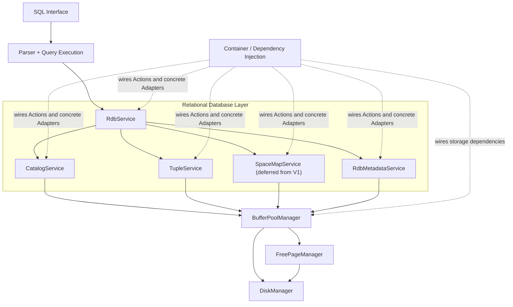
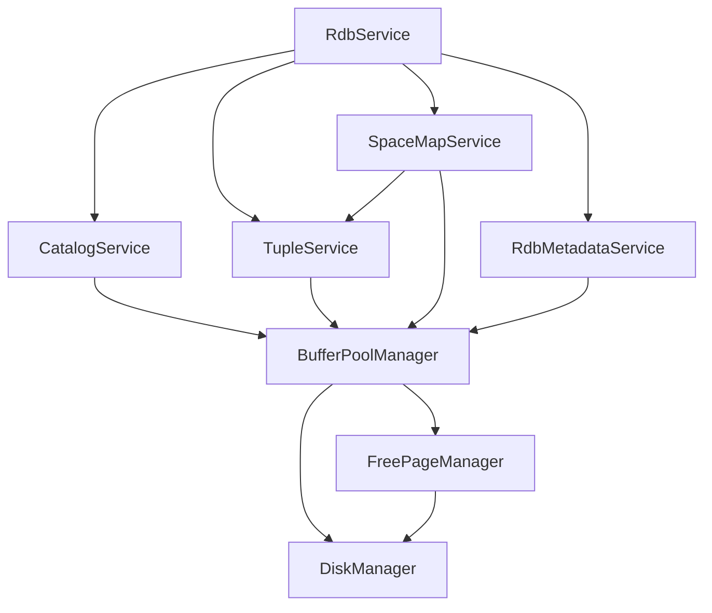

# UniDB V1 Architecture

## Architecture overview

## Declared service dependency graph

This diagram mirrors the nodes and directed edges declared in
[`architecture/serviceGraph.h`](architecture/serviceGraph.h). An arrow
`A --> B` means service `A` depends on or uses service `B`.

**V1 scope note:** `SpaceMapService` is currently represented in the repository's
service graph, but remains deferred from V1 acceptance criteria unless a concrete V1
operation requires it. The `SpaceMapService --> TupleService` edge reflects the
current implementation's tuple-page creation port; it should be revisited when SpaceMapService's
page-selection and page-creation responsibilities are refactored.
