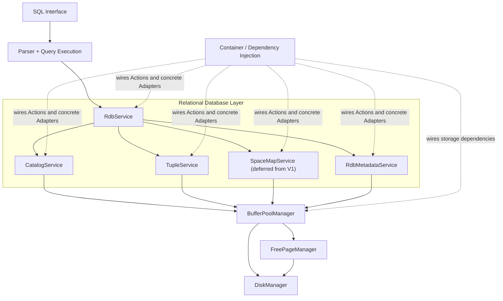
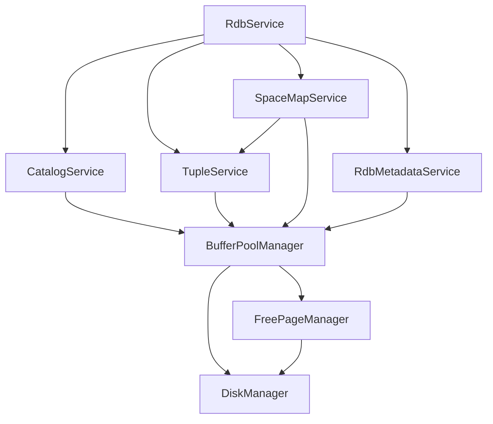

# UniDB V1 Architecture

## Architecture overview



## Declared service dependency graph

This diagram mirrors the nodes and directed edges declared in
[`architecture/serviceGraph.h`](architecture/serviceGraph.h). An arrow
`A --> B` means service `A` depends on or uses service `B`.



**V1 scope note:** `SpaceMapService` is currently represented in the repository's
service graph, but remains deferred from V1 acceptance criteria unless a concrete V1
operation requires it. The `SpaceMapService --> TupleService` edge reflects the
current implementation's tuple-page creation port; it should be revisited when SpaceMapService's
page-selection and page-creation responsibilities are refactored.


## Running UniDB

Build the project first:

```bash
cmake -S . -B build && cmake --build build
```

The executable supports lifecycle subcommands. Run them from the repository root (or use the path to your built executable):

```bash
./build/unidb start --db-path ./database.db --port 7432
./build/unidb connect --port 7432
./build/unidb stop --db-path ./database.db --port 7432
```

- `start` launches the TCP server in the background and waits until its loopback listener is reachable.
- `connect` opens an interactive session; enter one SQL statement per line. Press Ctrl+D to disconnect.
- `stop` sends a graceful shutdown signal and waits for the server process to exit so it can flush dirty pages.
- The default database path is `database.db`; the default port is `7432`. Use the same database path for `start` and `stop`.
- The PID file is stored as `<database-path>.pid`, the lifecycle lock as `<database-path>.lifecycle.lock`, and the server log as `<database-path>.log`. If startup fails, inspect the log.
- `start` and `stop` commands using the same database path are serialized with a lifecycle lock so concurrent startup or stale-PID cleanup cannot overwrite or remove a replacement server's PID file.
- The background child waits on a parent-child startup handshake until its PID record is flushed and closed; if the launcher exits before releasing the child, it exits before opening the database.
- The background `start` command currently supports macOS and Linux; other platforms receive an explicit error before a child process is launched. The foreground `--server` mode remains available.
- PID-file writes are flushed and closed, and both operations are checked before startup can report success.
