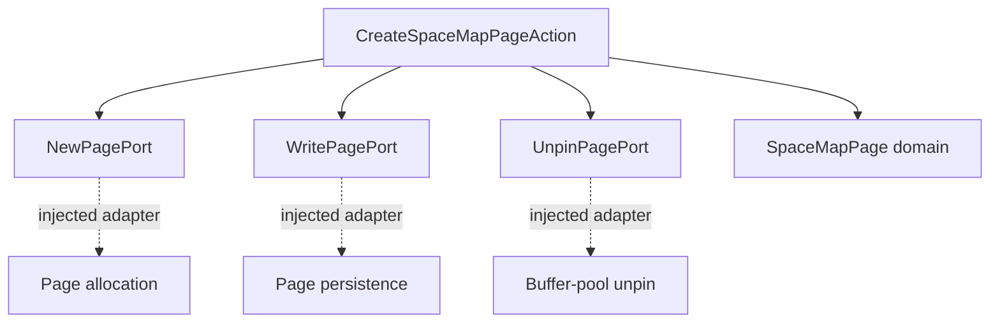
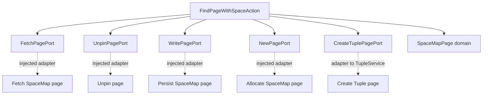
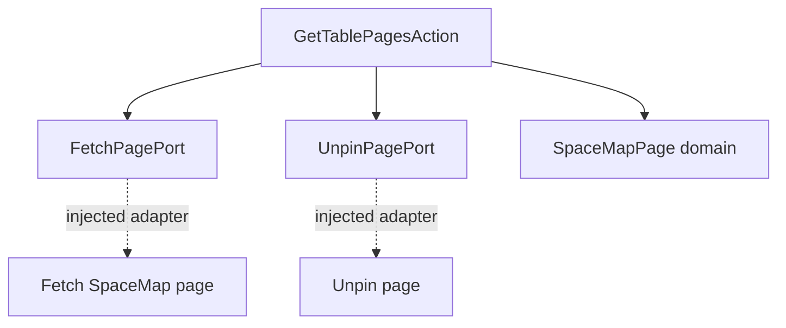
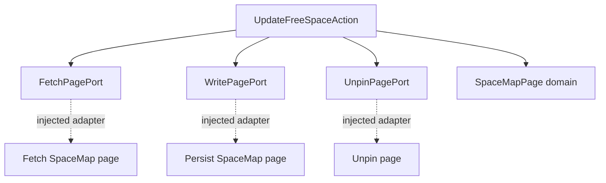

# SpaceMapService

## Actions at a glance

| Action | Responsibility (one line) | Required ports |
|---|---|---|
| `CreateSpaceMapPageAction` | Allocates, initializes, persists, and unpins a new SpaceMap page, then returns its page ID. | `NewPagePort`, `WritePagePort`, `UnpinPagePort` |
| `FindPageWithSpaceAction` | Finds a Tuple page with enough free space, creating and registering a new Tuple page (and extending the SpaceMap chain when needed) if necessary. | `FetchPagePort`, `UnpinPagePort`, `WritePagePort`, `NewPagePort`, `CreateTuplePagePort` |
| `GetTablePagesAction` | Traverses a table's SpaceMap-page chain and returns its Tuple page IDs in traversal order. | `FetchPagePort`, `UnpinPagePort` |
| `UpdateFreeSpaceAction` | Updates the recorded free-space value for a Tuple page in a SpaceMap page and persists the change. | `FetchPagePort`, `WritePagePort`, `UnpinPagePort` |

## Action dependency graphs

These graphs show each Action's direct dependencies. The Container injects concrete adapters for the ports; Actions depend on port interfaces rather than concrete adapters.

### CreateSpaceMapPageAction

### FindPageWithSpaceAction

### GetTablePagesAction

### UpdateFreeSpaceAction

## Notes

- `SpaceMapPage` owns the page-level metadata operations, including searching, inserting, updating, and following the next-page link.
- `FindPageWithSpaceAction` uses `CreateTuplePagePort` to request Tuple-page creation; it does not directly depend on TupleService implementation details.
- `GetTablePagesAction` treats the supplied root as the table's first SpaceMap page and detects cycles in the SpaceMap-page chain.
